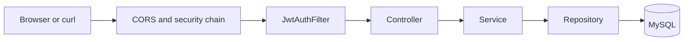

# Request lifecycle

> **Audience:** Backend developers  
> **Purpose:** Explain how an HTTP call becomes a database change  
> **Last verified:** 2026-10-19  
> **Source of truth:** `SecurityConfig`, `JwtAuthFilter`, controllers, and `ExceptionAdvisor`

## Path

## Authentication

`SecurityConfig` disables CSRF, allows the configured frontend origins, and keeps the session stateless.

Public routes:

- `OPTIONS /**`
- `POST /payroll-management/v1/login`
- `/payroll-management/v1/forgot-password/**`
- `/actuator/**`

Every other route requires `Authorization: Bearer <token>`.

`JwtUtil` signs tokens with HS256 for 10 hours and stores `tenantId` and `storeId` as claims. The signing secret is currently compiled into `JwtUtil`; treat that as a defect to externalize, and do not copy the value into docs or tickets.

`CustomUserDetailsService` loads the user and active store-role rows. Authorities are `ROLE_<ROLE_NAME>` plus each comma-separated permission on those roles.

## Authorization is uneven

Class-level `@PreAuthorize` protects:

- `RoleController` with `MANAGE_ROLES`, except module catalog and staff-role lookup
- `LeavePlanAdminController` with `MANAGE_LEAVES`
- `SStaffShiftsController` with `MANAGE_SHIFTS`

Selected salary and leave-approval methods add their own checks. Many staff, attendance, holiday, dashboard, payslip, sync, and payroll-trigger routes are only JWT-authenticated. Hidden frontend controls are not a security boundary.

`SecurityUtils` replaces positive request tenant and store IDs with JWT values when a controller calls it. It does not prove that a requested staff or record belongs to that tenant.

## Response shapes

Do not assume one envelope.

| Shape | Used by |
| --- | --- |
| `LoginResponse` | Login |
| `ResponseModel` through `ResponseHandler` | Older attendance and staff flows |
| `{ message, code, timestamp, data }` | `ResponseHandler` |
| Entity, list, or map | Newer leave and role flows |
| PDF or Excel bytes | Payslip download endpoints |

`ExceptionAdvisor` returns timestamp, status, error, and message for validation and common persistence failures. Some controllers catch exceptions themselves and return `{ "error": "..." }`.

## Tenant data

Most queries are scoped by `tenantId` and `storeId` columns. There is no database row-level security. A new endpoint must derive scope from the authenticated user and reject a resource outside that scope before reading or writing it.

## Where to add a route

1. Add the method to the existing feature controller, or create one under `/payroll-management/v1`.
2. Require the narrowest existing permission. Add a new permission only when the UI and seed catalog are updated together.
3. Validate the body with the existing DTO style.
4. Enforce tenant, store, and staff ownership in the service.
5. Cover the happy path and a cross-tenant rejection with a test.
6. Update the API and permission pages in the frontend documentation portal.
